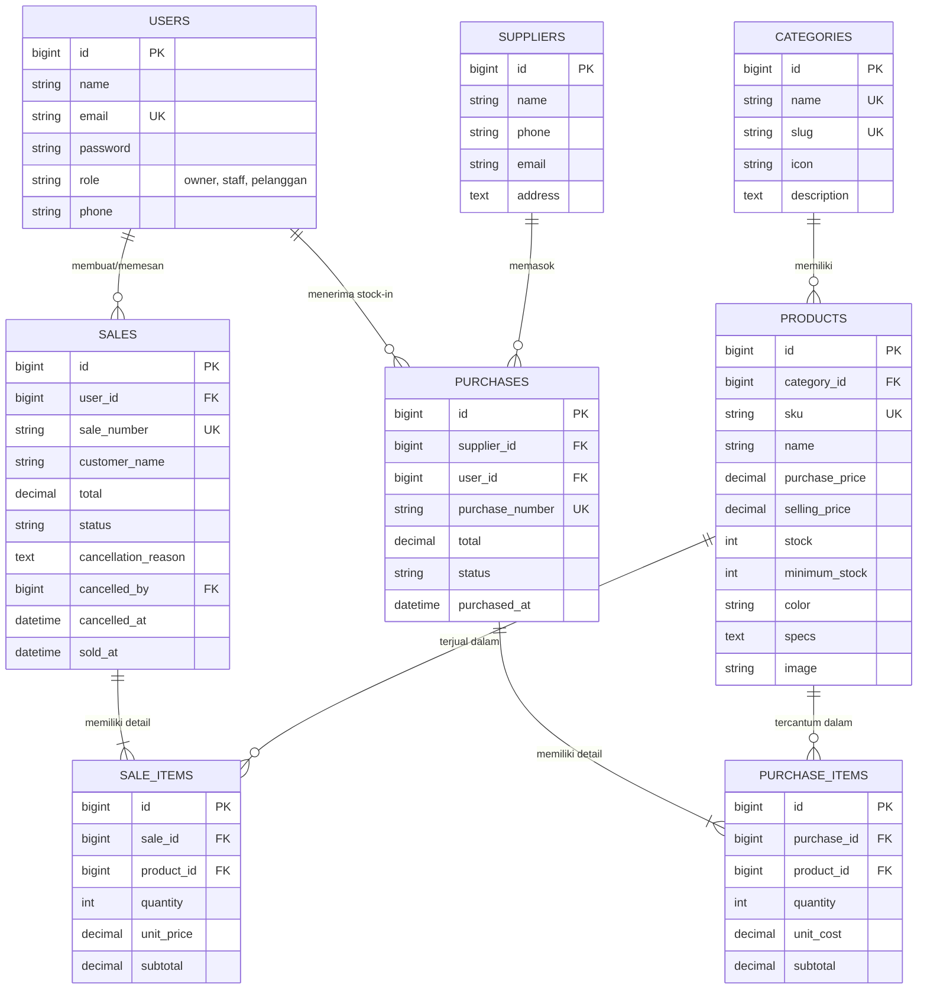

# 🌸 ladydevice.store — Integrated Laravel Inventory & Sales Management System

Aplikasi bisnis terintegrasi **ladydevice.store** (Toko Laptop Estetik & Sistem Manajemen Inventaris - POS) yang dibangun menggunakan **Laravel 12, MySQL, Eloquent ORM, Autentikasi Multi-Role, Otorisasi Middleware, dan Logika Transaksi Atomik**.

Dibuat untuk memenuhi seluruh kualifikasi dan rubrik penilaian **Ujian Tengah Semester (UTS) Web Programming 2**.

---

## 📋 Daftar Akun Demo (Credentials)

Sistem telah dilengkapi seeder akun untuk 3 role pengguna utama dengan kredensial bawaan:

| Peran (Role) | Email | Kata Sandi | Area Akses Utama |
| :--- | :--- | :--- | :--- |
| **Owner (Pemilik Toko)** | `owner@ladydevice.store` | `password` | Dashboard Utama, **Konfirmasi Pembatalan Pesanan & Restorasi Stok**, Manajemen Pengguna/Staff, Seluruh Master Data & Transaksi. |
| **Admin / Staff** | `staff@ladydevice.store` | `password` | Kasir Penjualan (POS), Pembelian (Stock-In), Kelola Produk, Kategori, Supplier. *(Dilarang mengonfirmasi pembatalan atau kelola pengguna)*. |
| **Pelanggan (Customer)** | `pelanggan@ladydevice.store` | `password` | Etalase Laptop Estetik, Keranjang Belanja, Checkout Pesanan, Lacak Pesanan Saya, Ajukan Pembatalan. *(Dilarang masuk dashboard pengelola)*. |

> [!IMPORTANT]
> **Kebijakan Keamanan Akun:** Kata sandi seluruh akun tidak diisi otomatis oleh tombol referensi, melainkan wajib diketik manual oleh pengguna (`password`) demi menjamin keamanan dan mencegah akses tidak sah.
> 
> **Wajib Login Pelanggan:** Pengunjung harus melakukan login sebagai **Pelanggan** terlebih dahulu sebelum dapat menambahkan laptop ke troli belanja atau memproses checkout pesanan.

---

## ✨ Fitur-Fitur Utama Sesuai Spesifikasi

### 1. Desain Toko Digital Kekinian & Estetik (`ladydevice.store`)
- Nuansa visual elegan *modern chic* (paduan warna lembut *Rose*, *Lilac*, *Frost*, dan tipografi *Plus Jakarta Sans* & *Playfair Display*).
- Menampilkan laptop estetik bergaransi resmi: MacBook Air M2/M3, ASUS Zenbook OLED Lilac Mist, Dell XPS Frost White, HP Spectre x360, Lenovo Yoga Slim Aura, dan ROG Zephyrus White.
- Badge stok real-time (*Tersedia*, *Stok Menipis / Kritis*, *Stok Habis*).

### 2. Multi-Metode Pembayaran (QRIS, Transfer Bank, Tunai di Butik)
- **QRIS Instant:** Dilengkapi QR Code dinamis simulator untuk pembayaran instan via BCA Mobile, GoPay, OVO, Dana, ShopeePay, dan Livin' Mandiri.
- **Transfer Bank:** Nomor rekening resmi (BCA & Mandiri) dengan tombol salin rekening instan.
- **Cash / Tunai di Toko:** Pembayaran saat pengambilan unit langsung di butik fisik *ladydevice.store*.

### 3. Diagram & Grafik Penjualan Otomatis (Chart.js)
- **Tren Penjualan 7 Hari Terakhir:** Grafik area gradien interaktif yang mengagregasikan omset penjualan harian langsung dari database secara real-time.
- **Porsi Penjualan per Kategori Laptop:** Diagram donat (*doughnut chart*) otomatis menghitung kontribusi omset per segmen laptop.
- **Daftar Laptop Terlaris (*Best Seller*):** Perhitungan agregat kuantitas unit terjual.

### 4. Konfirmasi Pembatalan Pesanan Khusus Dashboard Owner
- Sesuai instruksi khusus, hak pembatalan pesanan dan restorasi stok **hanya ada dan hanya dapat dieksekusi di Dashboard Owner**.
- Ketika Owner mengonfirmasi pembatalan:
  1. Dijalankan dalam transaksi atomik database (`DB::transaction`).
  2. Mengunci data produk dengan `lockForUpdate()`.
  3. Mengembalikan stok laptop secara otomatis (`$product->increment('stock', $qty)`).
  4. Mencatat nama Owner pemverifikasi dan waktu pembatalan.

### 5. Pemisahan Portal Login & Proteksi "Akses Terlarang" (403 Forbidden)
- **Tiga Halaman Login Terpisah Berdasarkan Role:**
  1. **Portal Pelanggan:** `http://127.0.0.1:8000/login` (Aesthetic Soft Rose Boutique) – khusus pelanggan untuk katalog, troli belanja, dan checkout.
  2. **Portal Admin / Staff:** `http://127.0.0.1:8000/login/admin` (High-Tech Indigo Terminal) – khusus staff untuk kasir POS, stok masuk, dan kelola produk.
  3. **Portal Owner:** `http://127.0.0.1:8000/login/owner` (Executive Obsidian Gold Suite) – khusus pemilik bisnis untuk otorisasi pembatalan dan diagram keuangan.
- **Proteksi Akses Terlarang Antar Portal:**
  - Jika akun mencoba login di portal yang tidak sesuai dengan role terdaftarnya (misal: Pelanggan mencoba masuk via `/login/admin` atau `/login/owner`, atau Staff mencoba masuk via `/login/owner`), sistem menolak otentikasi dan langsung menampilkan **Halaman Estetik 403: Akses Terlarang**.
  - Dilengkapi tombol navigasi cerdas yang langsung mengarahkan pengguna ke portal login yang tepat.
  - Dilindungi middleware server-side `EnsureRole` (`role:owner`, `role:owner,staff`) untuk proteksi rute internal backoffice.
- **Keamanan Input Kredensial:** Kolom email dan kata sandi disetel murni kosong tanpa auto-fill / auto-complete demi privasi dan keamanan akun.

### 6. Keranjang Belanja & Graceful Recovery Stok Habis/Error
- **Wajib Login Pelanggan:** Pengunjung diarahkan masuk ke akun Pelanggan sebelum dapat memasukkan laptop ke troli atau berbelanja.
- **Penanganan Error:** Jika produk kehabisan stok, kuantitas melebihi batas, atau terjadi kesalahan checkout, sistem secara anggun mengembalikan pengguna ke halaman awal (`/`) disertai pesan peringatan yang jelas dan ramah.

### 7. Transaksi Pembelian (Stock-In) & Penjualan (Stock-Out / POS)
- **Pembelian (Stock-In):** Staff memilih supplier, menambahkan beberapa item laptop dinamis, kuantitas, dan harga kulak. Stok otomatis bertambah saat berhasil.
- **Penjualan (Stock-Out):** Staff kasir memilih produk dan kuantitas, serta metode pembayaran kasir (QRIS, Transfer, Cash). Sistem mengecek stok tersedia dengan `lockForUpdate()`, menolak jika stok tidak cukup, dan memotong stok hanya ketika transaksi berhasil disimpan.
- Seluruh harga dan subtotal dihitung di sisi server (*Server-Side Validation*), bukan dari input browser yang rawan manipulasi.

---

## 🗄️ Model Data & Entity Relationship Diagram (ERD)



---

## 🚀 Panduan Instalasi & Menjalankan Project

### 1. Prasyarat Sistem
- PHP >= 8.2 (dengan ekstensi pdo_mysql, mbstring, openssl)
- MySQL / MariaDB (XAMPP / standalone)
- Composer >= 2.x

### 2. Langkah Demi Langkah

1. **Kloning atau Buka Folder Project:**
   ```bash
   cd c:\xampp_Old1\htdocs\ladydevice.store
   ```

2. **Pastikan Konfigurasi Database di `.env`:**
   ```env
   DB_CONNECTION=mysql
   DB_HOST=127.0.0.1
   DB_PORT=3306
   DB_DATABASE=ladydevice_db
   DB_USERNAME=root
   DB_PASSWORD=
   ```

3. **Jalankan Migration & Database Seeder:**
   ```bash
   php artisan migrate:fresh --seed
   ```
   *Perintah ini akan membuat semua tabel dan mengisi kategori laptop, supplier resmi, produk berfoto estetik, nota transaksi awal, dan 3 akun pengguna.*

4. **Jalankan Server Lokal Laravel:**
   ```bash
   php artisan serve
   ```
   Aplikasi dapat langsung diakses di browser: `http://127.0.0.1:8000`

---

## 🎓 Pertanyaan Kunci Code Ownership & Penjelasan Logika

Berikut adalah penjelasan teknis untuk persiapan wawancara dosen (*Slide 24 UTS*):

1. **Mengapa Sale memiliki relasi hasMany ke SaleItem?**
   > Transaksi penjualan menerapkan prinsip normalisasi database (*1-to-many*). Satu transaksi (*header*) dapat memuat beberapa variasi produk yang dibeli dengan kuantitas dan harga satuan masing-masing pada tabel detail `sale_items`.

2. **Di mana sistem memastikan stok tidak menjadi negatif?**
   > Di `SaleController@store` dan `StoreController@checkout`, sebelum stok dikurangi, sistem memeriksa `$product->stock < $qty`. Jika stok tidak mencukupi, sistem melempar `ValidationException` atau `Exception` yang otomatis membatalkan operasi tanpa mengubah data sama sekali.

3. **Mengapa total penjualan dihitung di server?**
   > Untuk keamanan (*tamper-proof*). Nilai harga dari browser pengguna dapat dimodifikasi menggunakan Developer Tools. Menghitung `subtotal = $product->selling_price * $qty` langsung dari data di database server menjamin keaslian nominal tagihan.

4. **Apa risiko jika pengurangan stok dilakukan di luar DB::transaction?**
   > Risiko hilangnya integritas data (*race condition* dan data setengah tersimpan). Jika pembuatan nota penjualan berhasil tetapi penyimpanan item berikutnya gagal, stok bisa berkurang tanpa tercatat atau nota tercipta tanpa stok berkurang. `DB::transaction` menjamin prinsip **Atomicity** (semua sukses atau semua dibatalkan/rollback).

5. **Bagaimana mencegah Staff atau Pelanggan mengakses URL langsung ke halaman yang terlarang?**
   > Menggunakan route middleware `role:owner` dan `role:owner,staff` di `routes/web.php` yang divalidasi oleh `App\Http\Middleware\EnsureRole`. Jika akun tidak memenuhi peran yang disyaratkan, server langsung merespons dengan HTTP Status **403 Forbidden** (Tampilan Akses Terlarang).

6. **Apa peran lockForUpdate()?**
   > Menerapkan *pessimistic row locking* di level MySQL untuk mencegah masalah *overselling* saat beberapa staf kasir atau pelanggan online membeli produk yang sama dalam detik yang bersamaan.

7. **Bagaimana produk yang pernah dipakai dalam transaksi dilindungi dari penghapusan?**
   > Model `Product` menggunakan `SoftDeletes`. Di `ProductController@destroy`, sistem mengecek relasi `$product->hasTransactions()`. Jika produk memiliki riwayat transaksi, ia diarsipkan (*soft delete*) sehingga relasi riwayat masa lalu tetap utuh.
